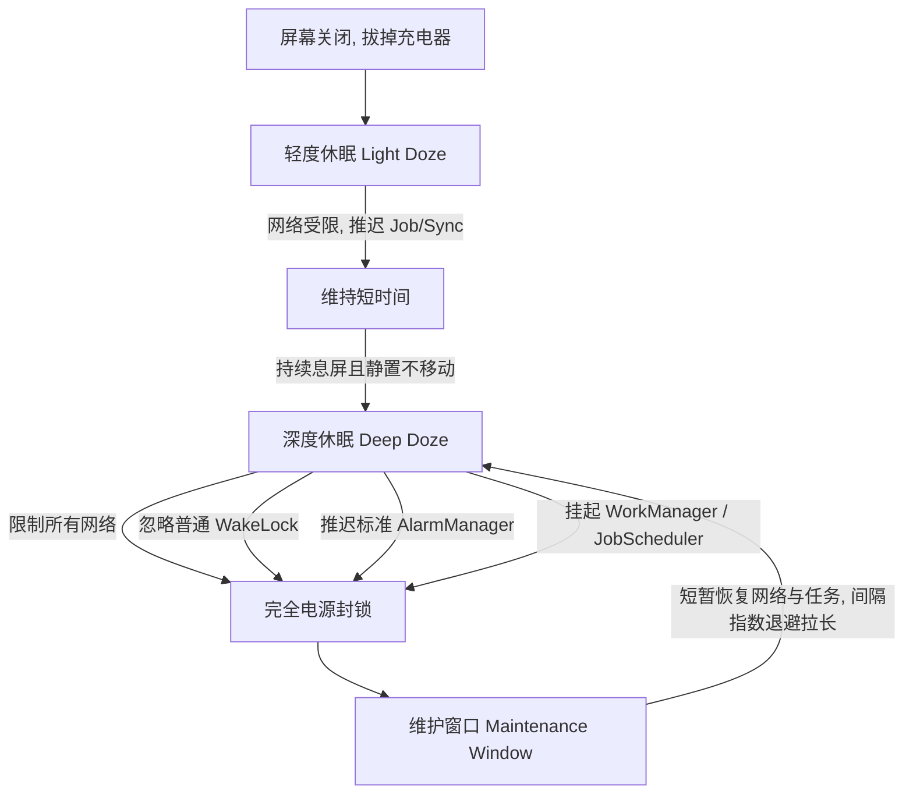
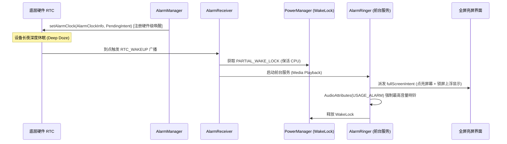

# Android 深度休眠与精准闹钟唤醒技术指南 (Deep Sleep & Alarm Survival Guide)

## 1. 概述与核心痛点 (Overview & Background)

在 Android 系统中，开发一款“必须准时唤醒并响铃”的闹钟或日程提醒类应用，面临的最严峻挑战并非业务逻辑编写，而是**系统的多层级电源管理策略**以及**各大手机厂商（如华为、小米、OPPO、vivo 等）激进的后台冻结与省电机制**。

典型故障场景：
- **白天测试一切正常**：闹钟在设置后几分钟或应用刚切后台时能准时响铃。
- **长夜深度休眠失灵**：手机静置 4~8 小时（夜间）进入深度休眠后，早上设定的闹钟**完全不响、无声、延迟几十秒至数十分钟**，甚至直到用户手动点亮屏幕或解锁手机后才瞬间“补发”弹出。

本指南深入拆解 Android 底层电源机制（Doze Mode），并总结经过实战验证的**四重穿透长夜休眠架构方案**与排查验证标准。

---

## 2. Android 系统休眠全景机制解析 (Doze Mode Architecture)

自 Android 6.0 (API 23) 引入低电耗模式（Doze Mode），并在 Android 7.0+ 细化为双阶段休眠以来，系统对后台资源施加了严格限制：



### 2.1 轻度休眠 (Light Doze) vs 深度休眠 (Deep Doze)

| 状态类型 | 触发条件 | 对应用施加的限制 | 普通闹钟表现 |
| :--- | :--- | :--- | :--- |
| **Light Doze** | 息屏但设备可能在移动（如装在口袋走路） | 限制网络访问、推迟后台作业同步 | 普通 Alarm 仍可能触发 |
| **Deep Doze** | 息屏、无充电、**物理静止传感器无移动**超过一定阈值（长夜安放床头） | **忽略所有 WakeLock**、切断网络、**推迟一切普通 Alarm 与 Handler**、冻结进程 | **普通闹钟被强制推迟或彻底拦截**，直到下一个维护窗口或亮屏 |

### 2.2 维护窗口的指数退避 (Exponential Backoff)
进入 Deep Doze 后，系统仅会在间隔极其漫长的“维护窗口”短时间唤醒设备。随着休眠时间推移，维护窗口的间隔会从十几分钟逐渐拉长至数小时。如果在长夜静置期间使用普通定时器，闹钟绝无按时唤醒的可能。

---

## 3. 厂商激进省电与后台冻结 (OEM Custom Power Management)

以华为（EMUI / HarmonyOS）、小米（MIUI / HyperOS）为代表的国产 ROM，在原生 Android 之上叠加了更激进的管控策略：

1. **Linux cgroup 进程深度冻结 (Process Freezer)**：
   - 应用退至后台一段时间后，其主线程及所有工作线程直接被内核级挂起，进程无法执行任何指令。
2. **纯净后台管控 (Auto-launch Restriction)**：
   - 禁止应用自启动、关联启动，且非系统白名单应用在后台被快速杀掉（OOM Adj 降级）。
3. **静音策略与通知屏蔽 (DND & Audio Silencing)**：
   - 夜间即使广播触发，若音频流通道未正确绑定闹钟专用通道（`STREAM_ALARM`），音频输出将被系统一键静音。

---

## 4. 穿透长夜休眠的四重核心架构方案 (The 4 Pillars)

为了保证闹钟在哪怕长达 10 小时的深度休眠中依旧 100% 毫秒级准时破冰响铃，必须严格落实以下四重支柱：



### 支柱一：`AlarmManager.setAlarmClock()` —— 硬件 RTC 特权级唤醒

绝不要使用普通的 `set()`、`setExact()`，甚至不要依赖 `setExactAndAllowWhileIdle()`！

- **为什么不用 `setExactAndAllowWhileIdle()`？**
  Android 官方明确规定：系统对 `setExactAndAllowWhileIdle` 施加了频次限制（每个应用每 9 分钟最多触发一次），并且在深度 Doze 下不能点亮系统状态栏闹钟图标，厂商省电策略极易将其延迟。
- **唯一真正可靠的 API：`setAlarmClock()`**
  ```kotlin
  val alarmClockInfo = AlarmManager.AlarmClockInfo(
      triggerTimeMillis,
      showIntent // 用户在系统锁屏/状态栏点击闹钟图标时打开的界面
  )
  alarmManager.setAlarmClock(alarmClockInfo, operationPendingIntent)
  ```
  **核心机理**：
  - 系统将其标记为**用户明确感知的真实物理闹钟**（User-facing Alarm）。
  - 底层直接写入 Linux 硬件 RTC（`Next wake from idle: ...`）。
  - 自动在手机状态栏右上角常驻显示“闹钟图标”，厂商系统会给予最高级别的抗休眠与防杀豁免权。

---

### 支柱二：`WakeLock` 链式保活 —— 杜绝广播执行间隙 CPU 复睡

当硬件 RTC 触发广播到系统启动 Service 之间，存在几毫秒至数百毫秒的空隙。如果此时 CPU 重新休眠，Service 将无法执行。

必须在 `BroadcastReceiver.onReceive()` 中立即获取 `PARTIAL_WAKE_LOCK`，确保 CPU 全程运转：

```kotlin
class AlarmReceiver : BroadcastReceiver() {
    override fun onReceive(context: Context, intent: Intent) {
        val powerManager = context.getSystemService(Context.POWER_SERVICE) as PowerManager
        val wakeLock = powerManager.newWakeLock(
            PowerManager.PARTIAL_WAKE_LOCK,
            "myapp:AlarmWakeLock"
        ).apply {
            setReferenceCounted(false)
            acquire(3 * 60 * 1000L) // 设置超时安全阀（如3分钟），防止异常耗尽电池
        }

        try {
            // 启动前台响铃服务
            val serviceIntent = Intent(context, AlarmRinger::class.java).apply {
                putExtras(intent)
            }
            ContextCompat.startForegroundService(context, serviceIntent)
        } finally {
            // 确保移交或安全释放
        }
    }
}
```

---

### 支柱三：前台服务与锁屏全屏穿透 (`fullScreenIntent`)

Android 10+ 严格限制后台启动 Activity。必须通过**前台服务 + 高优先级通知 + fullScreenIntent** 实现锁屏点亮弹窗：

#### 1. Activity 锁屏显示配置 (Manifest 或代码)：
```kotlin
override fun onCreate(savedInstanceState: Bundle?) {
    super.onCreate(savedInstanceState)
    if (Build.VERSION.SDK_INT >= Build.VERSION_CODES.O_MR1) {
        setShowWhenLocked(true)
        setTurnScreenOn(true)
    } else {
        window.addFlags(
            WindowManager.LayoutParams.FLAG_SHOW_WHEN_LOCKED or
            WindowManager.LayoutParams.FLAG_TURN_SCREEN_ON or
            WindowManager.LayoutParams.FLAG_DISMISS_KEYGUARD
        )
    }
    window.addFlags(WindowManager.LayoutParams.FLAG_KEEP_SCREEN_ON)
}
```

#### 2. 全屏通知配置：
```kotlin
val fullScreenPendingIntent = PendingIntent.getActivity(
    context, alarmId, fullScreenIntent,
    PendingIntent.FLAG_UPDATE_CURRENT or PendingIntent.FLAG_IMMUTABLE
)

val notification = NotificationCompat.Builder(context, CHANNEL_ID)
    .setSmallIcon(R.drawable.ic_alarm)
    .setContentTitle("闹钟响铃")
    .setPriority(NotificationCompat.PRIORITY_MAX)
    .setCategory(NotificationCompat.CATEGORY_ALARM)
    .setVisibility(NotificationCompat.VISIBILITY_PUBLIC)
    .setFullScreenIntent(fullScreenPendingIntent, true) // 核心：锁屏直接全屏覆盖
    .build()

startForeground(NOTIFICATION_ID, notification)
```

---

### 支柱四：音频通道与勿扰/静音穿透 (AudioAttributes)

很多时候闹钟准时触发了，但用户却“听不到声音”，是因为音频被路由到了通话或媒体通道，或者被系统勿扰模式屏蔽。

必须将 `MediaPlayer` / `SoundPool` 的音频属性显式绑定为 `USAGE_ALARM`：

```kotlin
val audioAttributes = AudioAttributes.Builder()
    .setUsage(AudioAttributes.USAGE_ALARM)                         // 标识为闹钟
    .setContentType(AudioAttributes.CONTENT_TYPE_SONIFICATION)     // 提示音类型
    .setFlags(AudioAttributes.FLAG_AUDIBILITY_ENFORCED)            // 强制出声（忽略系统静音）
    .build()

mediaPlayer.setAudioAttributes(audioAttributes)
mediaPlayer.setAudioStreamType(AudioManager.STREAM_ALARM)
```

**关键优势**：
- 走独立的系统闹钟音量滑块，用户手机即使静音/振动，闹钟通道依然能按闹钟预设音量播放。
- 自动穿透 Android 原生勿扰模式 (Do Not Disturb, DND) 的音频静音策略。

---

## 5. 重复周期的长效排期闭环 (Recurring Scheduling)

Android 的 `setRepeating()` 在 API 19+ 变成了非精确时间。对于周期性闹钟（如“每周一至周五 07:30”），**必须采用单次精确排期 + 触发后原子再排期**模式：

```kotlin
fun calculateNextTriggerTime(hour: Int, minute: Int, daysOfWeek: Int): Long {
    val now = Calendar.getInstance()
    var target = Calendar.getInstance().apply {
        set(Calendar.HOUR_OF_DAY, hour)
        set(Calendar.MINUTE, minute)
        set(Calendar.SECOND, 0)
        set(Calendar.MILLISECOND, 0)
    }

    if (daysOfWeek == 0) {
        // 单次闹钟：如果今天已过，则顺延到明天
        if (target.before(now)) {
            target.add(Calendar.DAY_OF_YEAR, 1)
        }
        return target.timeInMillis
    }

    // 重复闹钟：按星期掩码计算下一个匹配日（从当天开始向后循环 7 天）
    for (i in 0..7) {
        val checkCalendar = (target.clone() as Calendar).apply { add(Calendar.DAY_OF_YEAR, i) }
        val dayOfWeekBit = 1 shl (checkCalendar.get(Calendar.DAY_OF_WEEK) - 1)
        if ((daysOfWeek and dayOfWeekBit) != 0) {
            if (checkCalendar.after(now)) {
                return checkCalendar.timeInMillis
            }
        }
    }
    return target.timeInMillis
}
```

**触发后的原子续订**：
- 当当天闹铃触发时，立即在 `AlarmReceiver` 或持久层（Room）中重新计算下一次触发时间，并**再次调用 `setAlarmClock()`**。
- 监听四大系统事件广播，防止时间失真：
  - `ACTION_BOOT_COMPLETED`（关机重启后恢复排期）
  - `ACTION_TIME_SET`（用户手动更改系统时间）
  - `ACTION_TIMEZONE_CHANGED`（时区变更）
  - `ACTION_MY_PACKAGE_REPLACED`（应用升级覆盖安装）

---

## 6. ADB 调试与休眠排查命令集 (Verification Cheat Sheet)

在真机上验证深度休眠唤醒能力，无需苦等一整夜，可通过 ADB 强制模拟深度休眠。

### 6.1 查看当前系统硬件 RTC 唤醒锁状态
```powershell
# 查看系统下一个从休眠中唤醒硬件的精确时间与归属包名
adb shell dumpsys alarm | grep -E "Next wake from idle|Pending alarm"
```
> **成功标志**：若输出包含 `Next wake from idle: ... {com.your.package/com.your.receiver}`，即表示已经成功注册入 CPU 硬件 RTC 唤醒队列！

### 6.2 强制设备步进至深度休眠 (Deep Doze)
```powershell
# 1. 拔掉 USB 供电模拟（假拔线）
adb shell dumpsys battery unplug

# 2. 息屏
adb shell input keyevent 26

# 3. 强制设备直接进入 Deep Doze 状态
adb shell dumpsys deviceidle force-idle deep

# 4. 查看当前 Doze 状态 (应显示 IDLE 或 IDLE_MAINTENANCE)
adb shell dumpsys deviceidle step
```

### 6.3 检查电池优化白名单 (Battery Optimizations)
```powershell
# 查询应用是否在 Doze 白名单中
adb shell dumpsys deviceidle whitelist | grep com.your.package

# 弹出系统电池白名单申请对话框（引导用户开启）
# Intent(Settings.ACTION_REQUEST_IGNORE_BATTERY_OPTIMIZATIONS, Uri.parse("package:$packageName"))
```

### 6.4 恢复设备电量状态
```powershell
adb shell dumpsys battery reset
```

---

## 7. 最佳工程实践 Checklist (Production Checklist)

- [x] **API 选用**：坚持使用 `AlarmManager.setAlarmClock()`，坚决放弃不可靠的模糊定时。
- [x] **系统状态栏标识**：确保手机状态栏显示闹钟小图标，以此换取系统与厂商的最高豁免权。
- [x] **全屏亮屏意图**：Notification 设置 `setFullScreenIntent()`，Activity 声明 `setShowWhenLocked(true)` 与 `setTurnScreenOn(true)`。
- [x] **音频强制策略**：`AudioAttributes` 必须包含 `USAGE_ALARM`，流类型指定 `STREAM_ALARM`。
- [x] **广播 CPU 锁**：`BroadcastReceiver` 收到瞬间即持有 `PARTIAL_WAKE_LOCK`，防止 Service 启动前 CPU 掉进睡眠。
- [x] **自愈广播全监听**：开机（`BOOT_COMPLETED`）、校时（`TIME_SET`）、时区变更（`TIMEZONE_CHANGED`）全量重新对齐排期。
